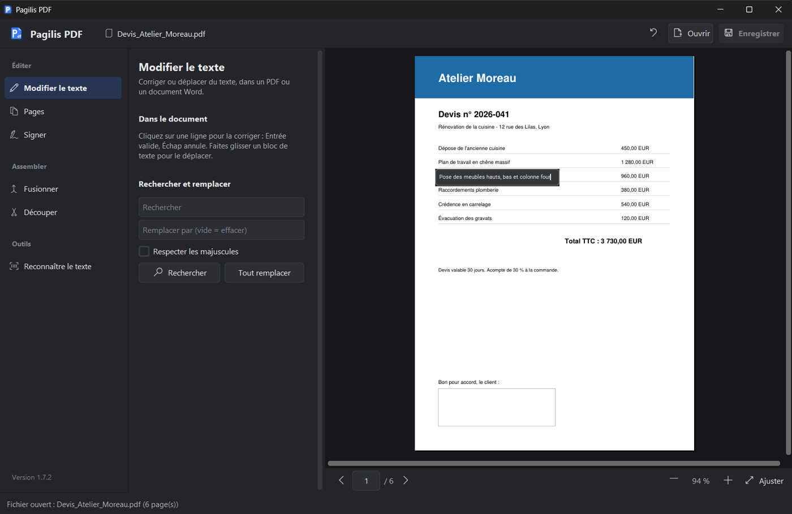
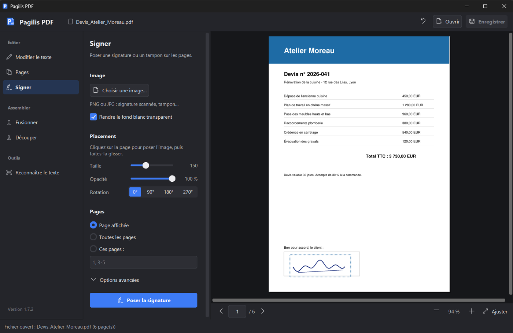
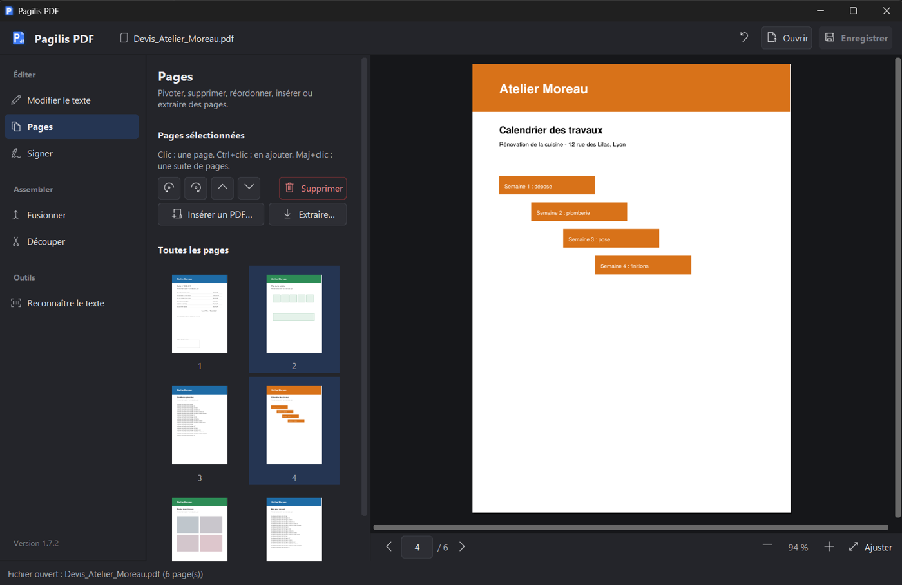
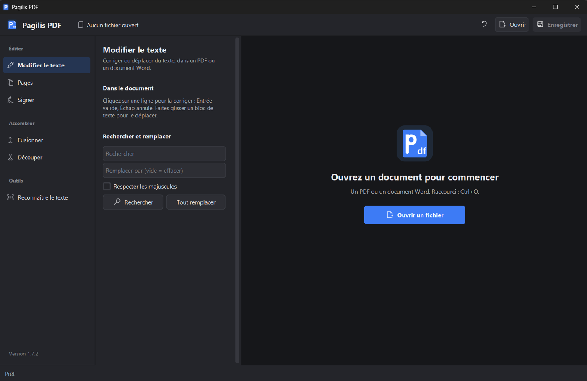
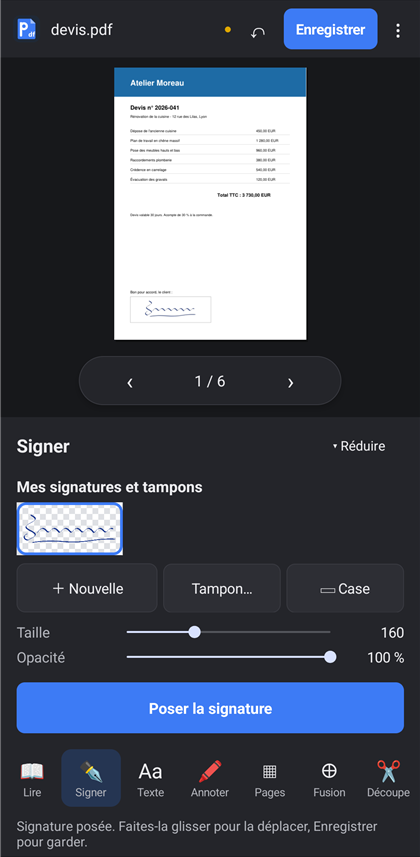
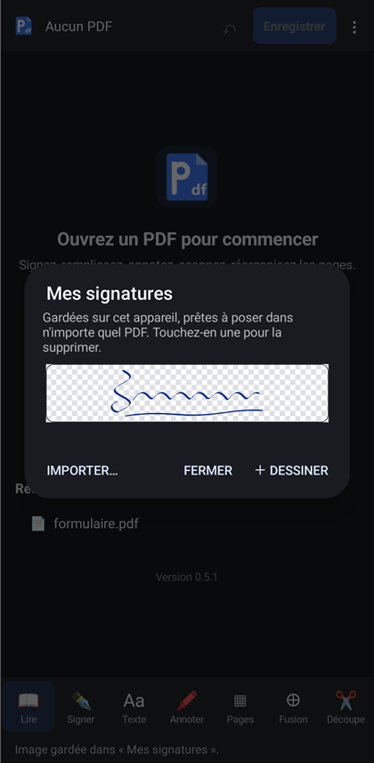
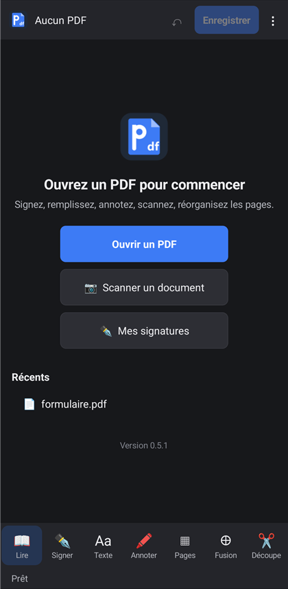

<p align="center">
  
</p>

<h1 align="center">Pagilis PDF</h1>

<p align="center">
  <strong>Signez, corrigez et organisez vos PDF sur PC Windows et sur tablette ou téléphone Android.</strong><br>
  Gratuit, sans compte et sans abonnement. Vos documents ne quittent jamais votre appareil.
</p>

<p align="center">
  <a href="https://github.com/Jonathanmx5/Pagilis-PDF/releases/latest"></a>
  <a href="https://github.com/Jonathanmx5/Pagilis-PDF/releases?q=android&expanded=true"></a>
  
</p>

<p align="center">
  
</p>

---

## En 10 secondes

Un devis à signer, une faute dans un contrat ou un scan à envoyer : **Pagilis PDF le fait sans
détour.** Vous ouvrez le document, vous faites la retouche, vous enregistrez. Vous n'avez ni compte
à créer, ni abonnement à payer, ni fichier à envoyer sur un serveur inconnu.

- 🔒 **100 % local.** Vos contrats, factures et pièces d'identité restent sur votre PC ou votre tablette.
- 💸 **Gratuit pour toujours.** C'est un logiciel libre, sans publicité ni version « Pro » cachée.
- ⚡ **Prêt tout de suite.** Sur PC, un seul fichier à lancer, sans installation. Sur Android, une application légère.
- 🔄 **Toujours à jour.** Chaque nouvelle version est proposée dans l'application et s'installe en un toucher.
- ↩️ **Sans risque.** Chaque retouche s'annule, et l'original reste intact tant que vous n'enregistrez pas.

## Téléchargez

<table>
  <tr>
    <th width="50%">💻 PC Windows 10 et 11</th>
    <th width="50%">📱 Tablette et téléphone Android 8 ou plus récent</th>
  </tr>
  <tr>
    <td>
      <a href="https://github.com/Jonathanmx5/Pagilis-PDF/releases/latest"><b>⬇ Télécharger Pagilis.exe</b></a><br><br>
      Lancez-le, c'est tout. Pour une installation durable, cliquez sur <i>Installer sur ce PC</i> dans
      l'application : aucun droit administrateur n'est demandé.
    </td>
    <td>
      <a href="https://github.com/Jonathanmx5/Pagilis-PDF/releases?q=android&expanded=true"><b>⬇ Télécharger PagilisPDF.apk</b></a>
      (version <code>android-v…</code> la plus récente)<br><br>
      Ouvrez le fichier sur l'appareil. Android vous demande une fois d'autoriser l'installation,
      puis les mises à jour arrivent d'elles-mêmes.
    </td>
  </tr>
</table>

## Ce que vous pouvez faire

| | Fonction | 💻 PC | 📱 Android |
|---|---|:---:|:---:|
| 🖋️ | **Signer** : signature tracée à la main (trait de stylo plume), ou tampon PNG transparent | ✅ | ✅ |
| ✍️ | **Plusieurs signatures gardées** (signature complète, initiales, tampon), créées même sans PDF ouvert | ✅ | ✅ |
| ▭ | **Cases de signature** : préparez « Signer ici : Client », remplissez la vôtre d'un clic | ✅ | ✅ |
| ✏️ | **Corriger le texte existant** : cliquez sur la ligne, tapez, la police d'origine est gardée | ✅ | |
| 🔤 | **Ajouter du texte** : date, « Lu et approuvé », mention en un geste | ✅ | ✅ |
| 📋 | **Remplir les formulaires PDF** : champs, cases à cocher, listes | | ✅ |
| 🖍️ | **Annoter** : surligner, stylo, cadre, note | | ✅ |
| 📄 | **Pages** : réordonner en glissant, pivoter, supprimer, insérer, extraire | ✅ | ✅ |
| 🔗 | **Fusionner** plusieurs PDF, et ✂️ **Découper** un PDF en plusieurs | ✅ | ✅ |
| 📷 | **Scanner** un document avec l'appareil photo : recadré et blanchi | | ✅ |
| 🔍 | **Rechercher** dans le document | ✅ | ✅ |
| 🔠 | **Reconnaître le texte d'un scan (OCR)** en 5 langues | ✅ | |
| 📝 | **Ouvrir un document Word** et le corriger | ✅ | |
| 📧 | **Copie allégée** pour l'envoyer par e-mail | | ✅ |
| 🔐 | **Copie protégée par mot de passe** (AES-256) ou **verrouillée** une fois signée | | ✅ |
| 🛟 | **Copies de secours** automatiques avant chaque remplacement | | ✅ |

## En images

### 💻 Sur PC Windows

<table>
  <tr>
    <td width="50%"><br>
      <sub><b>Signer</b> : créez votre signature une fois, posez-la à la souris.</sub></td>
    <td width="50%"><br>
      <sub><b>Pages</b> : sélectionnez, pivotez, réordonnez, extrayez.</sub></td>
  </tr>
  <tr>
    <td width="50%"><br>
      <sub><b>Corriger</b> : cliquez sur une ligne, tapez, Entrée.</sub></td>
    <td width="50%"><br>
      <sub><b>Accueil</b> : ouvrez un PDF ou un Word, ou reprenez un fichier récent.</sub></td>
  </tr>
</table>

### 📱 Sur tablette et téléphone Android

<table>
  <tr>
    <td width="33%"><br>
      <sub><b>Signer</b> : touchez la page, la signature se pose. Faites-la glisser pour l'ajuster.</sub></td>
    <td width="33%"><br>
      <sub><b>Mes signatures</b> : dessinées au doigt ou importées, prêtes pour tous vos PDF.</sub></td>
    <td width="33%"><br>
      <sub><b>Accueil</b> : ouvrir, scanner, gérer ses signatures, reprendre un récent.</sub></td>
  </tr>
</table>

Sur tablette et en mode paysage, les outils passent sur le côté pour laisser toute la place au document.

## Questions fréquentes

**Est-ce vraiment gratuit ?** Oui. Pagilis PDF est un logiciel libre (licence AGPL-3.0). Il n'y a
ni publicité, ni abonnement, ni fonction payante.

**Mes documents sont-ils envoyés quelque part ?** Non. Tout se fait sur votre appareil. La seule
connexion sert à vérifier s'il existe une nouvelle version de Pagilis PDF.

**Windows affiche un avertissement au premier lancement.** Le fichier n'est pas signé
numériquement, alors SmartScreen se méfie. Cliquez sur *Informations complémentaires*, puis sur
*Exécuter quand même*.

**Android parle de « source inconnue ».** L'application est distribuée ici, sur GitHub, et non sur
le Play Store. Autorisez l'installation une fois. Les mises à jour sont signées avec la même clé, et
Android refuserait une version falsifiée.

**Une signature dessinée a-t-elle une valeur légale ?** Elle vaut une signature manuscrite
scannée : c'est suffisant pour un devis ou un bon pour accord. Ce n'est pas une signature
électronique certifiée. Pour éviter les retouches après coup sur Android, enregistrez une *copie
verrouillée*.

## Bon à savoir

- **Polices (PC).** Le texte corrigé reprend la police d'origine quand le PDF l'embarque, ou quand
  elle est installée sur le PC. Sinon, il est réécrit en Arial, Times New Roman ou Courier New.
- **Une ligne corrigée (PC) prend un seul style**, celui de son morceau le plus long.
- **Recherche.** Une expression coupée entre deux lignes n'est pas trouvée.
- **Scans.** Sur PC, une page scannée doit passer par l'OCR pour devenir modifiable. Sur Android,
  un scan reste une image, sans texte à rechercher.
- **Fichiers Word (PC).** Leur ouverture nécessite Microsoft Word ou LibreOffice.
- **PDF protégés.** Sur PC, un PDF protégé par mot de passe est enregistré sans mot de passe.
- **En cas de souci sur PC,** le journal se trouve dans `%LOCALAPPDATA%\Pagilis\pagilis.log`.

Anciennement **PDF Studio** : les installations existantes passent automatiquement à
Pagilis PDF, préférences comprises.

---

## Pour les développeurs

### PC Windows

Application Python, avec une interface CustomTkinter, le moteur PDF
[PyMuPDF](https://pymupdf.readthedocs.io) et l'OCR Tesseract.

```bat
python -m pip install -r requirements-dev.txt
python -m pytest tests -q
python pagilis.py
```

| Fichier | Rôle |
|---|---|
| `pdf_core.py` | Logique PDF pure, sans interface : texte, polices, pages, OCR. |
| `edition.py` | Copie de travail : retouches, annulation, enregistrement. |
| `conversion.py` | Conversion Word → PDF, avec Word ou LibreOffice. |
| `pagilis.py` | Fenêtre principale : document ouvert, traitements en arrière-plan, barre d'état. |
| `pages/` | Une page par fonction ; le socle commun est dans `base.py`. Pour ajouter une fonction, créez un fichier et inscrivez-le dans `__init__.py`. |
| `apercu.py`, `fenetres.py` | Aperçu du document ; fenêtres de mise à jour et d'installation. |
| `theme.py` | Couleurs, polices, icônes et boutons. Aucun style n'est défini ailleurs. |
| `updater.py`, `installation.py` | Mises à jour sécurisées ; installation sans droits administrateur. |
| `outils/dessiner_logo.py` | Génère `ressources/logo.png` et `pagilis.ico`. |

La suite comprend plus de 220 tests, et la CI exige au moins 80 % de couverture. Les versions des
dépendances sont figées dans `requirements*.txt`.

**Compiler** : `build_exe.bat` analyse le code, lance les tests et produit `dist\Pagilis.exe`.

**Publier** :

1. Écrivez les notes de la version dans `CHANGELOG.md`, sous `## [X.Y.Z]`. Elles s'affichent dans
   la fenêtre de mise à jour, et la CI refuse une version sans notes.
2. Poussez le tag :

   ```bat
   git tag vX.Y.Z
   git push origin vX.Y.Z
   ```

   La CI lance les tests, construit l'exe, le vérifie, puis publie `version.json` et la release.

Un tag `-beta.N` publie une pré-version que l'application ne propose jamais d'elle-même.

**Sûreté des mises à jour** :

- L'empreinte SHA-256 est vérifiée après le téléchargement.
- La nouvelle version doit réussir `Pagilis.exe --verifier` avant de remplacer l'ancienne.
- La version précédente est sauvegardée dans `%LOCALAPPDATA%\Pagilis\version-precedente`.
- Si le remplacement échoue, l'ancienne version est restaurée.

### Android

Le projet est dans `android/` : Kotlin et [MuPDF](https://mupdf.com), sans autre bibliothèque.

```bat
cd android
gradlew testDebugUnitTest          :: calculs (sur le PC)
gradlew connectedDebugAndroidTest  :: moteur PDF (sur un émulateur ou un appareil branché)
gradlew assembleDebug
```

Les versions publiées sont signées avec la clé `android/pagilis-release.jks` (décrite par
`android/key.properties`). Cette clé est gardée sur le PC du mainteneur et n'est jamais commitée.
Sans elle, une nouvelle version ne peut pas s'installer par-dessus l'ancienne : sauvegardez ces
deux fichiers. Pour publier, depuis `android/` :

```bat
gradlew assembleRelease -PversionPagilis=X.Y.Z
gh release create android-vX.Y.Z app/build/outputs/apk/release/app-release.apk#PagilisPDF.apk --latest=false
```

Si les secrets `ANDROID_KEYSTORE_B64` et `ANDROID_KEYSTORE_PASSWORD` sont ajoutés au dépôt,
pousser un tag `android-vX.Y.Z` suffit : la CI signe et publie.

## Licence

Pagilis PDF est un logiciel libre, distribué sous licence [GNU AGPL-3.0](LICENSE), comme PyMuPDF
et MuPDF.
