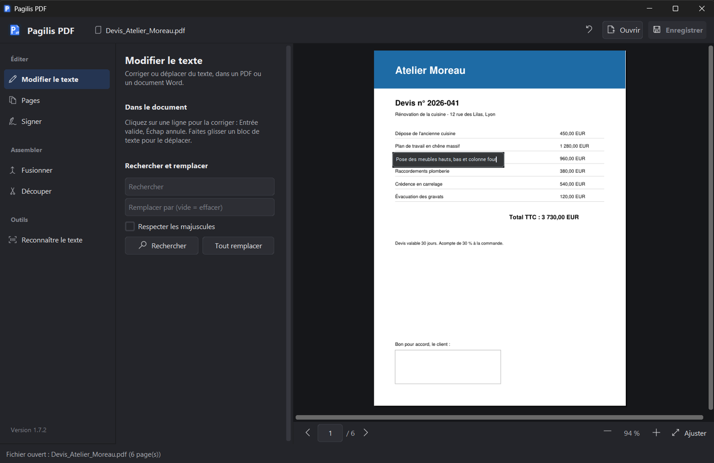
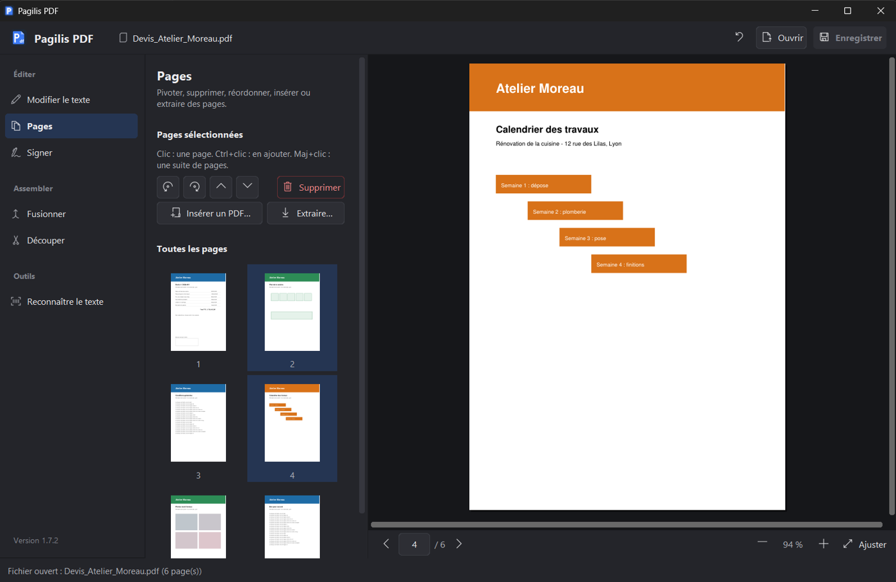
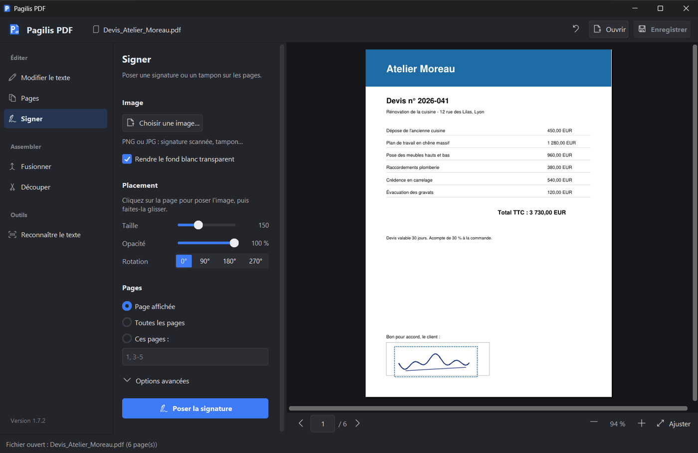
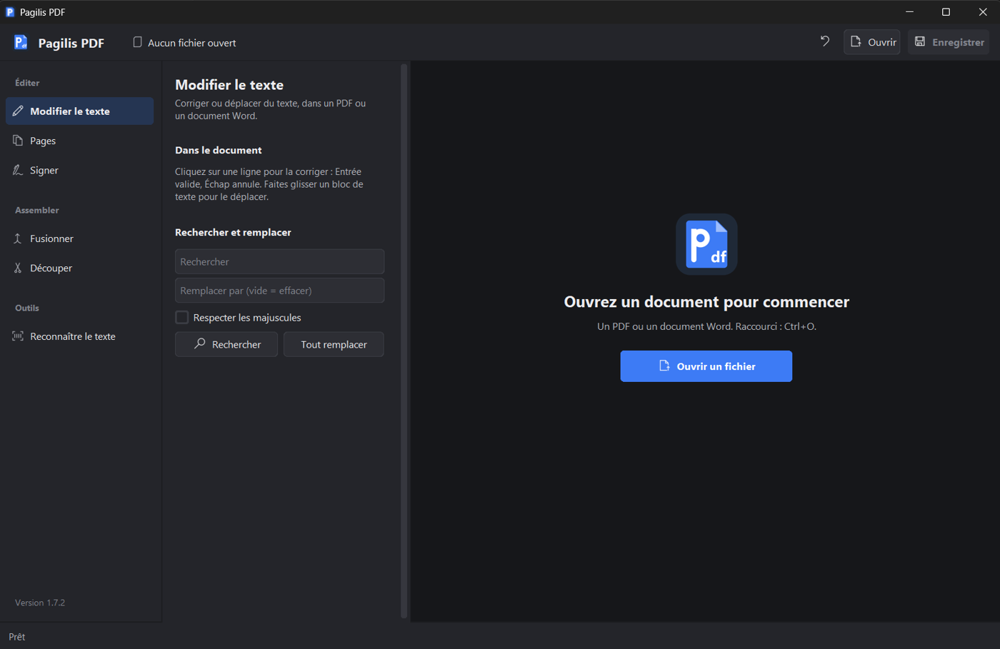

<p align="center">
  
</p>

<h1 align="center">Pagilis PDF</h1>

<p align="center">
  <strong>Corrigez, organisez et signez vos PDF en quelques clics.<br>
  Gratuit, sans compte, sans abonnement. Vos fichiers restent sur votre PC.</strong>
</p>

<p align="center">
  <a href="https://github.com/Jonathanmx5/Pagilis-PDF/releases/latest"></a>
  
  
</p>

<p align="center">
  
</p>

---

## Pourquoi Pagilis PDF ?

- **Corriger un PDF comme un document.** Une faute dans un PDF ? Cliquez sur la
  ligne, tapez, Entrée. La police d'origine est conservée.
- **Ouvrir aussi les documents Word.** Corrigez-les dans le même écran et
  récupérez un PDF propre.
- **Tout est local.** Aucun envoi sur internet et aucun compte à créer. Vos
  contrats, factures et pièces d'identité ne quittent pas votre ordinateur.
- **Prêt en une seconde.** Un seul fichier `Pagilis.exe` suffit, sans
  installation ni droits administrateur. Il fonctionne aussi depuis une clé USB.
- **Toujours à jour.** Chaque nouvelle version est proposée au démarrage. Elle
  est vérifiée avant de remplacer l'ancienne, et l'ancienne est gardée de côté.

## Ce que vous pouvez faire

| | Fonction | En pratique |
|---|---|---|
| ✏️ | **Modifier le texte** | Corriger une ligne d'un clic, déplacer un bloc d'un glisser, rechercher et remplacer dans tout le document. |
| 📄 | **Pages** | Vignettes de toutes les pages. Vous pouvez faire pivoter, supprimer, réordonner, insérer un autre PDF ou extraire une sélection. |
| 🖋️ | **Signer** | Apposer une signature ou un tampon (image), placée à la souris, avec la taille, l'opacité et l'orientation voulues. |
| 🔗 | **Fusionner** | Réunir plusieurs PDF en un seul, dans l'ordre choisi. |
| ✂️ | **Découper** | Une page par fichier, toutes les N pages, ou selon vos plages (1-3, 5, 8-). |
| 🔍 | **Reconnaître le texte (OCR)** | Rendre un scan cherchable et copiable, en français, anglais, allemand, espagnol ou italien. |

Les 20 dernières retouches se défont avec **Ctrl+Z**, et **Ctrl+S** enregistre.
Une pastille vous signale ce qui n'est pas encore sauvegardé.

## En images

<table>
  <tr>
    <td width="50%"><br>
      <sub><b>Pages</b> : sélectionnez, pivotez, réordonnez, extrayez.</sub></td>
    <td width="50%"><br>
      <sub><b>Signer</b> : posez votre signature à la souris.</sub></td>
  </tr>
  <tr>
    <td width="50%"><br>
      <sub><b>Accueil</b> : ouvrez un PDF ou un Word, ou reprenez un fichier récent.</sub></td>
    <td width="50%"><br>
      <sub><b>Modifier</b> : cliquez sur une ligne, tapez, Entrée.</sub></td>
  </tr>
</table>

## Installer

1. Téléchargez `Pagilis.exe` depuis la
   **[dernière version](https://github.com/Jonathanmx5/Pagilis-PDF/releases/latest)**.
2. Lancez-le. C'est tout.

Pour l'installer durablement, cliquez sur **Installer sur ce PC** en bas de la
barre latérale. L'installation ne demande aucun droit administrateur. Elle crée
les raccourcis du menu Démarrer et du Bureau, et ajoute Pagilis PDF dans
« Ouvrir avec » pour vos PDF. Vous pouvez la retirer depuis *Paramètres >
Applications installées*.

> Le fichier n'étant pas signé numériquement, Windows SmartScreen peut afficher
> un avertissement au premier lancement : cliquez sur *Informations
> complémentaires*, puis sur *Exécuter quand même*.

## Bon à savoir

- **Polices.** Le texte corrigé reprend la police d'origine quand le PDF
  l'embarque avec tous les caractères nécessaires, ou quand elle est installée
  sur le PC. Sinon, il est réécrit en Arial, Times New Roman ou Courier New,
  selon le style d'origine.
- **Une seule mise en forme par ligne corrigée.** Une ligne corrigée prend un
  seul style : celui de son morceau le plus long.
- **Recherche.** La recherche ne trouve pas une expression coupée entre deux
  lignes.
- **Scans.** Une page scannée doit d'abord passer à l'OCR pour devenir
  modifiable. Les pages à l'envers ou penchées ne sont pas encore redressées
  automatiquement.
- **Fichiers Word.** Leur ouverture nécessite Microsoft Word ou LibreOffice.
  Un document protégé par mot de passe ne s'ouvre pas. Le résultat est
  enregistré en PDF.
- **PDF protégés.** Un PDF protégé par mot de passe est enregistré sans mot de
  passe.
- **En cas de souci,** le journal se trouve dans `%LOCALAPPDATA%\Pagilis\pagilis.log`.

Anciennement **PDF Studio** : les installations existantes passent
automatiquement à Pagilis PDF, préférences comprises.

---

## Pour les développeurs

Application Python, avec une interface CustomTkinter, le moteur PDF
[PyMuPDF](https://pymupdf.readthedocs.io) et l'OCR Tesseract.

```bat
python -m pip install -r requirements-dev.txt
python -m pytest tests -q
python pagilis.py
```

| Fichier | Rôle |
|---|---|
| `pdf_core.py` | Logique PDF pure, sans interface : texte, polices, pages, OCR. |
| `edition.py` | Copie de travail : retouches, annulation, enregistrement. |
| `conversion.py` | Conversion Word → PDF, avec Word ou LibreOffice. |
| `pagilis.py` | Fenêtre principale : document ouvert, traitements en arrière-plan, barre d'état. |
| `pages/` | Une page par fonction ; le socle commun est dans `base.py`. Pour ajouter une fonction, créez un fichier et inscrivez-le dans `__init__.py`. |
| `apercu.py`, `fenetres.py` | Aperçu du document ; fenêtres de mise à jour et d'installation. |
| `theme.py` | Couleurs, polices, icônes et boutons. Aucun style n'est défini ailleurs. |
| `updater.py`, `installation.py` | Mises à jour sécurisées ; installation sans droits administrateur. |
| `outils/dessiner_logo.py` | Génère `ressources/logo.png` et `pagilis.ico`. |

La suite comprend plus de 220 tests. La CI exige au moins 80 % de couverture.
Les versions des dépendances sont figées dans `requirements*.txt`.

**Compiler** : `build_exe.bat` analyse le code, lance les tests et produit
`dist\Pagilis.exe`.

**Publier** :

1. Écrivez les notes de la version dans `CHANGELOG.md`, sous `## [X.Y.Z]`.
   Elles s'affichent dans la fenêtre de mise à jour, et la CI refuse une
   version sans notes.
2. Poussez le tag :

   ```bat
   git tag vX.Y.Z
   git push origin vX.Y.Z
   ```

   La CI lance les tests, construit l'exe, vérifie l'exe, puis publie
   `version.json` et la release.

Un tag `-beta.N` publie une pré-version que l'application ne propose jamais
d'elle-même.

**Sûreté des mises à jour** :

- L'empreinte SHA-256 est vérifiée après le téléchargement.
- La nouvelle version doit réussir `Pagilis.exe --verifier` avant de remplacer
  l'ancienne.
- La version précédente est sauvegardée dans
  `%LOCALAPPDATA%\Pagilis\version-precedente`.
- Si le remplacement échoue, l'ancienne version est restaurée.

## Licence

Pagilis PDF est un logiciel libre, distribué sous licence [GNU AGPL-3.0](LICENSE),
comme PyMuPDF.
